<table>
<tr>
<td valign="top"></td>
<td valign="top"></td>
</tr>
</table>

## Ashkan

**AI / ML Engineer & Software Developer**  
*NLP (ParsBERT) · Reinforcement Learning · Serverless & Edge Systems*

 

<!-- animated contribution graph, refreshed daily by GitHub Actions -->

